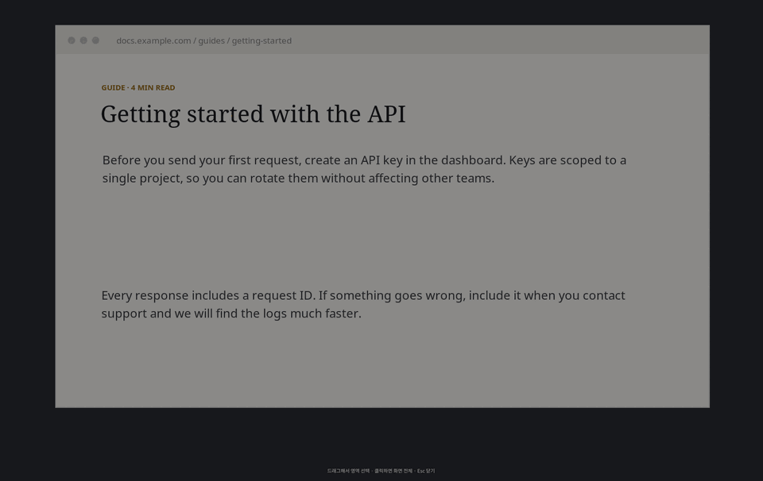
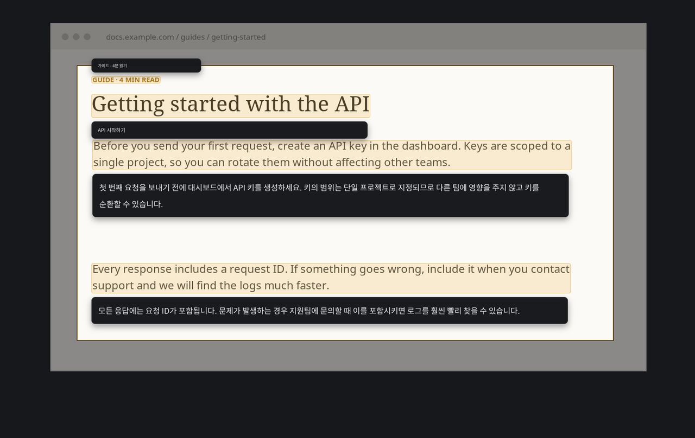
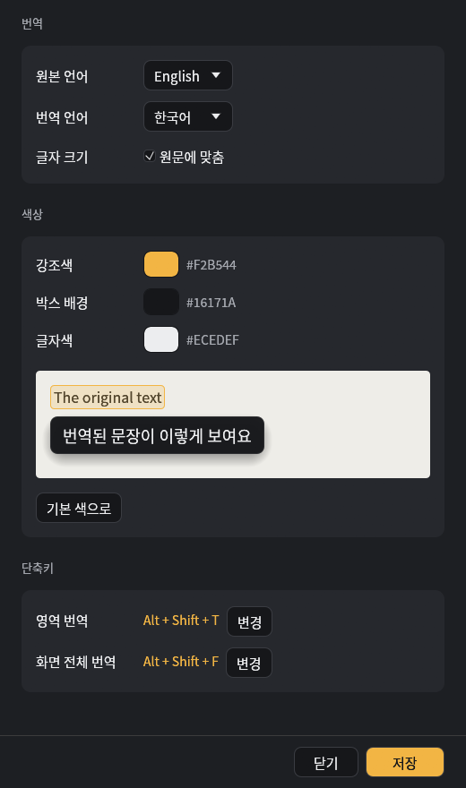

<div align="center">

# snaptr

**화면을 드래그하면, 그 자리에서 번역.**

화면 일부를 고르면 글자를 OCR로 읽고, 번역문을 원문 바로 위나 아래에 띄워 줍니다.<br>
Windows · Linux (X11) · Rust 단일 바이너리



</div>

## 특징

- **그 자리 번역**: 번역 박스가 원문 블록 바로 위나 아래에 붙습니다. 남는 공간을 보고 위치를 정하고, 자리가 있으면 박스끼리 겹치지 않게 놓습니다.
- **클릭 한 번으로 복사**: 번역 박스를 누르면 번역문, 하이라이트된 원문을 누르면 원문이 복사됩니다. `Ctrl+C`는 전체 번역을 복사합니다.
- **트레이 상주 + 전역 단축키**: 기본값은 `Alt+Shift+T` (영역), `Alt+Shift+F` (화면 전체)입니다. 설정을 저장하면 바로 반영됩니다.
- **설정 창**: 원본/번역 언어, 글자 크기, 색상 3종, 단축키를 바꿀 수 있고 미리보기가 함께 나옵니다.
- **멀티 모니터**: 모든 모니터를 한 번에 얼려서 보여주고, 어느 모니터에서든 드래그할 수 있습니다.
- **가벼움**: 오버레이는 GPU 없이 CPU로 그립니다. 1920×1080 모니터 하나 기준 메모리는 약 57 MB이고, 화면이 클수록 늘어납니다.

<p align="center">
  
</p>

## 설치

### Linux (X11)

```sh
# OCR, 클립보드 의존성 (원본 언어에 맞는 tesseract 언어팩을 함께 설치)
sudo apt install tesseract-ocr tesseract-ocr-kor tesseract-ocr-jpn tesseract-ocr-chi-sim xclip

cargo build --release
install -Dm755 target/release/snaptr ~/.local/bin/snaptr
```

영어 원문만 쓸 거면 `tesseract-ocr` 하나로 충분합니다 (`eng` 기본 포함). 언어팩이 빠져 있으면 오버레이에 설치 명령이 안내됩니다.

GNOME에서 트레이 아이콘을 보려면 AppIndicator 확장이 필요합니다 (Ubuntu는 기본 탑재). 확장이 없어도 단축키는 동작합니다.

### Windows 10 / 11

```powershell
cargo build --release
# target\release\snaptr.exe
```

OCR은 Windows 내장 엔진(Windows.Media.Ocr)을 써서 따로 설치할 것이 없습니다. 다만 원본 언어의 **언어팩**은 깔려 있어야 합니다. 없으면 오버레이에 `설정 > 시간 및 언어 > 언어`에서 추가하라는 안내가 뜹니다.

Linux에서 Windows용으로 크로스 빌드하려면:

```sh
rustup target add x86_64-pc-windows-gnu
pip install ziglang && cargo install cargo-zigbuild
cargo zigbuild --release --target x86_64-pc-windows-gnu
```

## 사용법

```
snaptr                       설정 창 열기 (트레이도 백그라운드에서 같이 시작)
snaptr crop [--from L] [--to L]   드래그로 영역 선택해서 번역
snaptr full [--from L] [--to L]   커서가 있는 모니터 전체 번역
snaptr settings              설정 창만 열기
snaptr tray                  트레이 아이콘 + 전역 단축키 (상주)
```

`L`은 Google 번역 언어 코드입니다 (`en` `ko` `ja` `zh-CN` `zh-TW` `de` `fr` `es` `it` `pt` `ru` `vi` `th`). `--from`/`--to`를 생략하면 설정 창에서 저장한 값을 씁니다.

### 오버레이 조작

| 동작 | 결과 |
| --- | --- |
| 드래그 | 영역 선택 후 번역 |
| 클릭 또는 `Enter` | 커서가 있는 모니터 전체 번역 |
| 번역 박스 클릭 | 번역문 복사 |
| 하이라이트된 원문 클릭 | 원문 복사 |
| `Ctrl+C` | 번역문 전체 복사 |
| 결과 화면 빈 곳 드래그 | 새 영역 다시 번역 |
| `Esc` 또는 우클릭 | 닫기 |

## 설정



`snaptr`를 인자 없이 실행하거나 트레이 메뉴에서 **설정**을 누르면 열립니다.

- **번역**: 원본 언어, 번역 언어, 글자 크기 (`원문에 맞춤` 또는 12~48 px 고정)
- **색상**: 강조색, 박스 배경, 글자색 (미리보기 포함)
- **단축키**: `변경`을 누르고 원하는 조합을 누르면 됩니다. 수정키(Ctrl/Alt/Shift/Super)가 하나 이상 필요하고, 두 단축키가 같으면 저장되지 않습니다.

저장 위치는 Linux `~/.config/snaptr/config`, Windows `%APPDATA%\snaptr\config`입니다. `key = value` 형식의 텍스트 파일이라 직접 고쳐도 됩니다. 실행 중인 트레이가 1초 안에 변경을 감지해 단축키를 다시 등록합니다.

<br clear="right">

## 로그인 시 자동 실행

**Linux**: `~/.config/autostart/snaptr.desktop`

```ini
[Desktop Entry]
Type=Application
Name=snaptr
Exec=/home/YOUR_USER/.local/bin/snaptr tray
X-GNOME-Autostart-enabled=true
```

**Windows**: `Win+R` → `shell:startup` 폴더에 `snaptr.exe` 바로 가기를 만들고, 대상 끝에 ` tray`를 붙입니다.

트레이는 한 번에 하나만 뜹니다. 이미 실행 중이면 새로 띄운 트레이는 바로 종료됩니다.

## 동작 방식

```
단축키 ─▶ tray ─▶ snaptr crop ─▶ 화면 캡처 ─▶ OCR ─▶ Google 번역 ─▶ 오버레이에 배치
                                  (X11 / GDI)   (tesseract / Windows.Media.Ocr)
```

- 트레이, 오버레이, 설정 창은 각각 별도 프로세스입니다. 오버레이에 문제가 생겨도 트레이는 그대로 살아 있습니다.
- 오버레이는 winit + softbuffer, 설정 창은 egui(wgpu, 실패하면 OpenGL)로 그립니다.
- 번역은 키가 필요 없는 Google 번역 공개 엔드포인트를 씁니다. 비공식 경로라서 요청이 많으면 막힐 수 있습니다.

## 제약

- Linux는 X11 세션만 지원합니다 (Wayland 미지원).
- macOS는 지원하지 않습니다.
- Windows 빌드는 크로스 컴파일로만 검증했습니다.
